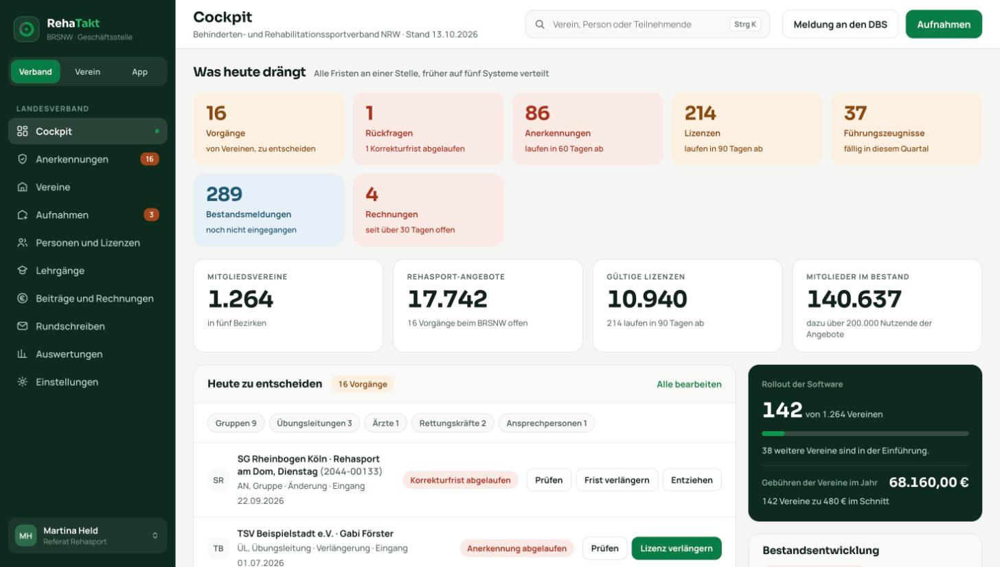
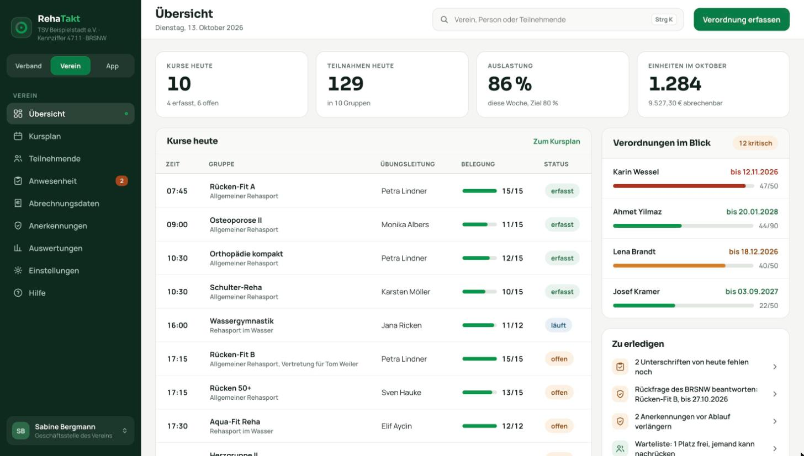
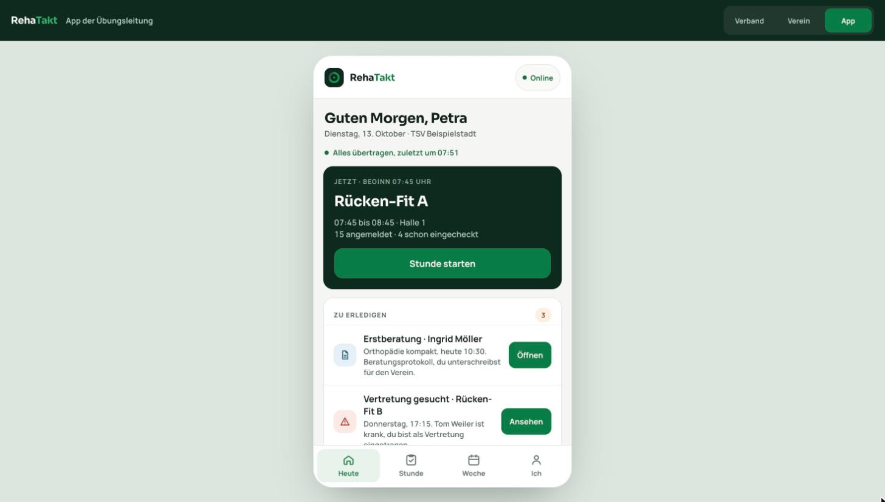

<div align="center">

# RehaTakt: clickable product prototype

**Administration software for rehabilitation sports (Rehasport) in Germany:
one product for the state association, its member clubs and the instructors running the sessions.**


</div>



| Club back office (Verein) | Instructor app (Übungsleitung) |
|---|---|
|  |  |

## Why

Rehabilitation sports in Germany run through a chain of state associations, thousands of local clubs, certified instructors,
doctors' prescriptions and the health insurers' billing centres. The tools in use today are spread across several legacy systems.
RehaTakt puts the whole chain into one product with a role per stakeholder. This prototype is the reference for every workflow and screen.

## What's inside

| File | What it is |
|---|---|
| `index.html` | **RehaTakt komplett**: association back office, club back office and instructor app in one page, with a role switcher (Verband · Verein · App) |
| `app.html` | The instructor app on its own (mobile-first) |

About 21,000 lines of hand-written HTML, CSS and vanilla JavaScript. No framework, no build step, no dependencies apart from two Google Fonts.
It has design tokens as CSS custom properties, automatic dark mode, and search on <kbd>Ctrl</kbd>/<kbd>⌘</kbd>+<kbd>K</kbd>.

## Domain coverage

**State association (Verband):** a cockpit of today's deadlines; approvals of rehab-sport groups (*Anerkennungen*) with correction deadlines; club admissions;
people and instructor licences, including certificates of good conduct; training courses; fees and invoices; circulars; reporting to the national federation; analytics.

**Club (Verein):** course schedule with occupancy; participants and their prescriptions (*Verordnungen*) with unit tracking and expiry warnings;
attendance with signatures; hand-over of checked billing data to the billing centre the club chooses; approvals; waiting list; settings and help.

**Instructor app (Übungsleitung):** today's sessions, starting a session and checking participants in, substitutions, first consultations, and the week ahead.

## Run it

Open `index.html` in any modern browser, or serve the folder:

```bash
python3 -m http.server 8000   # then open http://localhost:8000
```

## Notes

- The UI is German because the users are German clubs and associations.
- **All people, clubs, addresses and figures are fictional demo data** (`@beispiel.de` = "example").
- The prototype keeps all state in memory; many actions only show what would happen. It defines the workflows and the UI.
  The production system is developed in a separate private repository: from 12 module specifications, through gated work packages
  (tests, mutation testing, review), by a team of AI coding agents that I orchestrate.

---

© 2026 Hartmut Molzahn. All rights reserved.
